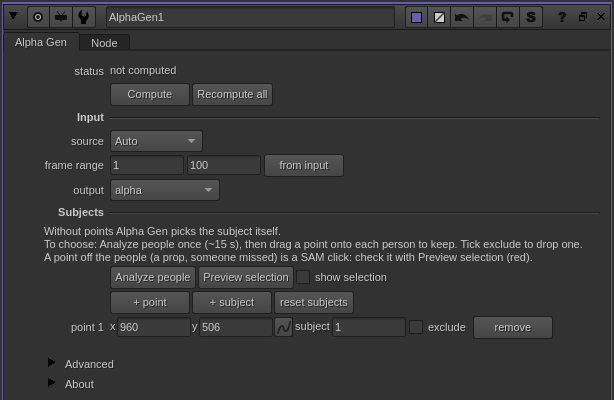
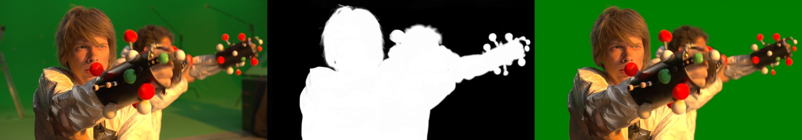
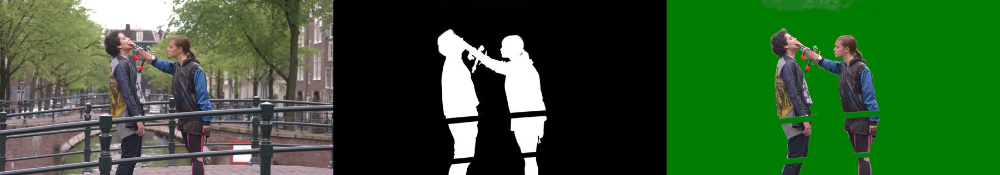
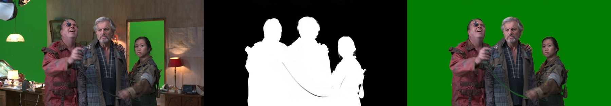

# Alpha Gen for Nuke

**Medratools > Alpha Gen** is a Nuke node that pulls a matte of the main subject out of a plate with Lightricks' **LTX-2.5 Alpha Gen** IC-LoRA. The model runs in a local ComfyUI; the node stages the plate, queues the job, and brings the matte back as an EXR sequence in `rgba.alpha` (or the node's own layer). You apply it to your original plate; it does not replace the image.

Optional **Subject points** let you choose who is kept: one click on a person selects the whole person, and the shot is tracked with SAM 2.1.



## What it does

Left: plate. Middle: Alpha Gen matte. Right: the plate keyed over green with that matte. Automatic subject selection, 544 px, seed 1234, no manual cleanup.





In the second shot the railing in front of the legs is left out of the matte, as it should be. Hair and the props held by the actors keep soft edges. Check edges and occlusions on your own plates before delivery; this is a generated matte, not ground truth.

*Footage: Tears of Steel (CC) Blender Foundation, mango.blender.org, CC BY 3.0.*

## Requirements

- Windows 10/11 or Linux, x86-64
- Nuke with Python 3 (tested on Linux with Nuke 13.2, 15.2 and 17.1)
- NVIDIA GPU with a driver that supports CUDA 13.0 (R580 or newer). 24 GB is recommended. A memory budget of about 8 GB was simulated at 544 px on a 24 GB card; a physical 8 GB card has not been tested.
- About 60 GB of free disk: ~40 GB of LTX weights and ~10 GB of Python environments. Optional Subject points add ~1.2 GB of SAM checkpoints and a second environment.
- 32 GB of RAM is a cautious starting point (a 72-frame test used 28.8 GB).
- A Hugging Face account

## Install

Download or clone this repository somewhere permanent (the Nuke menu points to it), then run the three steps in order:

| Step | Windows | Linux |
| --- | --- | --- |
| 1. Engine, backend, Nuke menu | `install.bat` | `./medratools.sh install` |
| 2. Model weights (~40 GB) | `download_models.bat` | `./medratools.sh models` |
| 3. Start the backend (leave it running while you use Nuke) | `start_backend.bat` | `./medratools.sh backend` |
| Optional: Subject points (SAM 2.1) | `medratools.bat sam` | `./medratools.sh sam` |

1. **install** sets up [uv](https://docs.astral.sh/uv/) if needed, creates the engine environment in `AlphaGen/.venv`, installs ComfyUI and ComfyUI-LTXVideo at the tested versions in `ComfyUI/`, and adds two lines ending in `# Medratools` to `~/.nuke/init.py` (`%USERPROFILE%\.nuke\init.py` on Windows).
   - To reuse an existing ComfyUI: `install --comfyui <path>`. It needs ComfyUI 0.38 or newer and the `ComfyUI-LTXVideo` custom nodes.
   - Another port: `install --port 8190`.
2. **models** needs you to accept the terms with your Hugging Face account on [Lightricks/LTX-2.5](https://huggingface.co/Lightricks/LTX-2.5) and [Lightricks/LTX-2.5-22b-IC-LoRA-Alpha-Gen](https://huggingface.co/Lightricks/LTX-2.5-22b-IC-LoRA-Alpha-Gen) first. It asks for a token if you are not logged in, skips files already present, and can be re-run after an interruption.
3. **backend** runs ComfyUI on `127.0.0.1:8188`. Run `medratools check` (`./medratools.sh check` or `medratools.bat check`) to confirm that weights, server and LTX nodes are ready.
4. **sam** is optional. It creates `RotoTrack/.venv` (a separate CUDA environment) and downloads and verifies the official SAM 2.1 Large and Base+ checkpoints. Without it the node still works in automatic-selection mode.

Restart Nuke after step 1. **Uninstall:** remove the two `# Medratools` lines from `init.py` and delete the folder.

## Use

1. With the backend running, add **Medratools > Alpha Gen** after a plate.
2. Leave **source** on Auto for a connected Read; choose Render input to include upstream nodes.
3. Set the frame range and **quality profile**. Choose **Quality (768)** for more processing detail, or **Economy (544)** for smaller VAE decode tiles. **Manual** (the default) keeps the resolution and tile settings in Advanced.
4. Optional: in **Subjects**, press **+ point** and drag the point onto the person or object you want, on the frame where you place it. **+ subject** adds another subject, **exclude** leaves an area out, and **Preview selection** tints the tracked selection in the output so you can check it before the expensive step. Turn **show preview** off before rendering.
5. Press **Compute**. The first run after starting the backend loads ~40 GB of weights before the first step.
6. Use the matte as the alpha of the original plate and refine it where needed. **Recompute all** ignores the cache.

7. No terminal needed for the backend: the node panel has **Start backend**, **Stop backend** and **Check backend** buttons (they use the installed `comfy` CLI, so `comfy-cli` must be on your PATH). Stop refuses while the ComfyUI queue is busy. From a shell: `python -m alphagen --backend start|stop|status`. Nodes saved before this version get the buttons from `alphagen_nuke.add_backend_knobs(node)`.

CLI (this is what the node runs): `python -m alphagen --input plate.####.exr --output alpha.####.exr --first 1001 --last 1072 --subject 1001 640 300`. `--subject FRAME X Y` is repeatable; X and Y are plate pixels from the top-left.

The panel and installer follow the system language (English or Portuguese). Set `MEDRATOOLS_LANG` to `pt` or `en` to force one.

### Quality profiles

| Profile | Processing short edge | VAE decode |
| --- | --- | --- |
| Manual | Advanced setting: 544, 768 or 1088 | Advanced small-tile override; automatic small tiles on GPUs up to 8 GB |
| Economy (544) | 544 | 256 px / 32-frame tiles |
| Quality (768) | 768 | 512 px / 128-frame tiles on GPUs above 8 GB; automatic small tiles on smaller GPUs |

The presets ignore the disabled Advanced resolution/tile controls without changing their saved values. Switching back to Manual restores their use. Existing nodes receive the selector when the script is opened and stay in Manual, so old projects keep their settings. Resolution and tiles already participate in the cache fingerprint: changing the effective settings recomputes the matte, while an unchanged profile can reuse its cache.

Quality increases the detail available to the model; it does not guarantee a better matte on every plate or try to fill VRAM. Both profiles still use tiled decoding. On the tested RTX 3090, Quality resolved more fine hair strands in the inspected frames, with a longer processing time. See the [72-frame comparison and measurements](docs/quality-profiles.md). Leave other ComfyUI generations idle; if memory runs out, use Economy or Manual at 544. 1088 remains a Manual setting and was not validated in this comparison.

The CLI uses the same existing controls: Economy is `--resolution 544 --low-vram`; Quality is `--resolution 768` without `--low-vram`.

### Selecting a whole person with one click (optional)

SAM alone answers a click on a face with the face. If ComfyUI's `models/detection/` holds `yolov10m.onnx` and `vitpose-l-wholebody.onnx`, the clicked person's body joints become extra include points and other people's joints become excludes, so one click selects the whole person (about 3 s on the CPU per preview). The installer does not fetch these two files. Without them, clicks alone seed SAM. Props held by the person are not covered by the joints; click them too.

### Picking people from a person map

**Analyze people** finds everyone on the current frame (YOLOv10 + SAM 2.1, seeded with the detected boxes) and tracks each person through the range into a numbered map. After that, selecting is instant, with no SAM run:

- Drag a point onto a person and they are kept; each person can have their own point, and every kept person stays a separate ID.
- Tick **exclude** on a point to take that person out. With only exclude points the result is *everyone but them*; with include points it is what you included minus what you excluded.
- Points off the map are ordinary SAM prompts.
- If every point ends up excluded, Compute stops with a message instead of silently falling back to automatic selection.

Accessories such as a monocle are recovered with a head candidate seeded on the key frame, and holes fully enclosed by one person are filled. The accessory is only guaranteed near the key frame; in profile, or with a hand in front, tracking can lose it. Re-analyze after changing the plate, range or version.

## How it was built

The node is three small pieces:

1. **The model, through ComfyUI's HTTP API.** `AlphaGen/alphagen/workflow_api.json` is the active path of the LTX-2.5 video-to-video, single-stage distilled workflow: the Alpha Gen adapter at strength 1.0, empty prompts, no image conditioning, no prompt enhancer and no paid API branch. Only five weight files are needed. The plate is resized without stretching, padded to 32-pixel dimensions and staged in ComfyUI's input folder, which is why the server must be local.
2. **Long shots in overlapping chunks.** The model handles up to 121 frames per segment, so longer ranges are cut into chunks of 121 real frames with at least 16 shared frames; the last chunk is always complete, so its overlap can be larger. Estimates of the same frame are blended linearly. There is no optical flow and no invented frame. VAE decode streams to disk, and seams are kept in float16 on disk to bound memory. The default decode tiles are 512 px / 128 frames; on GPUs up to 8 GB (or with `--low-vram`) they drop to 256 px / 32 frames, which uses less memory and changes matte edges slightly.
3. **Subject selection in a separate process.** Points are propagated through the shot in both directions with SAM 2.1 Base+. A click seeds the largest SAM mask candidate, because the highest-IoU one is often only a head or a garment. The optional YOLOv10 + ViTPose step above adds the person's body. The tracked mask is dilated by 4 px and softened by 1.5 px and only **crops** the Alpha Gen matte; it cannot recover a subject Alpha Gen missed. Before tracking, idle ComfyUI models are unloaded so SAM and the LTX model never share VRAM.

The Nuke side is a Python plugin built on a small shared helper, `aitools`, that runs the engine as a background job with progress and cancellation and writes the matte to an EXR cache. A manifest fingerprints the source frames, range, resolution, seed, subject points, tile override, output layer, workflow and model files. An exact match reuses the EXRs without ComfyUI running; any missing frame or changed point recomputes the whole shot so old and new estimates never mix.

## Measured limits

- 144-frame forward/reverse smoke test at 544 px with Subject points and overlap: 364 s on a 24 GB RTX 3090 with other processes holding memory. The effective budget was about 7.7 GiB; sampled peaks were 7,774 MiB for ComfyUI and 1,352 MiB for SAM (run one after the other), with 115 MiB free at the tightest sample. **This is not a test on a physical 8 GB GPU.**
- Small decode tiles against the original cache on a 72-frame test: mean MAE 0.0059, 2.8% of pixels differing by more than 0.05. Contours, hair and props change; do not assume equal quality.
- A single click on a gun selected both actors' guns in one test; the largest SAM candidate can also join subjects that touch. Use **Preview selection**.
- Verified on a clean Linux account: `install` (engine and ComfyUI environments, Nuke menu) and the node loading in Nuke 17.1; `check` correctly reports the missing weights.
- Not verified: a physical 8 GB GPU, Windows, the 40 GB model download and the SAM download from scratch, and quality on a long continuous shot.
- Nuke 17.1 crashed (SIGSEGV in the native OpenEXR reader) when Python `node.sample()` ran while the Viewer was rendering the EXRs. The cause is not isolated. Avoid scripted sampling of a live Viewer.
- Do not start other ComfyUI generations during Compute; the queue check is not an atomic reservation.
- Full-HD (1920x1088) inference is documented for H100/B200-class GPUs.

## Tests

```bash
cd AlphaGen
PYTHONPATH=../aitools python -m pytest -q tests
```

## Licenses

- This repository's own code: see the license file once one is added.
- The LTX-2.5 model and the Alpha Gen adapter are under the [LTX-2 Community License](https://github.com/Lightricks/LTX-2/blob/main/LICENSE-2_x). They are not distributed here; you accept the terms with Lightricks when downloading. Commercial use by an entity with annual revenue of US$10 million or more requires a paid license from Lightricks.
- SAM 2.1 source and configs (`RotoTrack/vendor/sam2`) and the checkpoints are Apache-2.0, Meta/FAIR. No weights are included.
