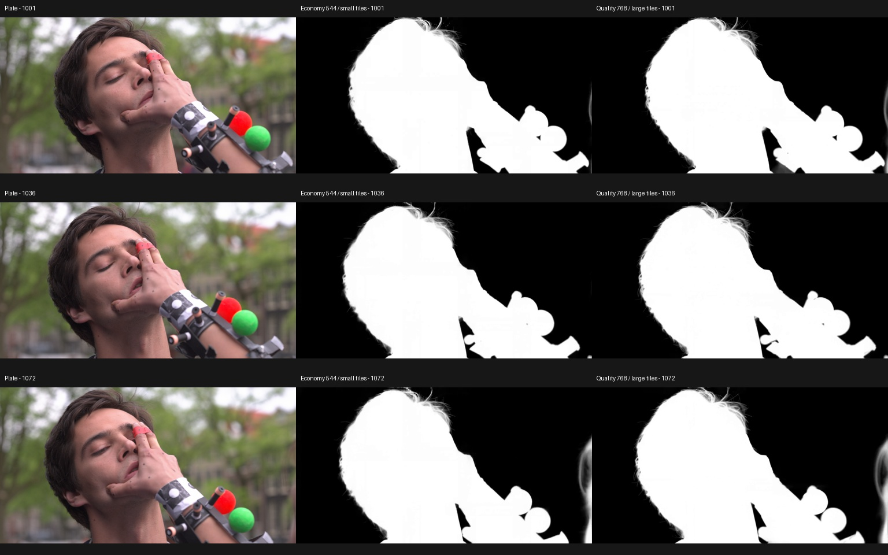
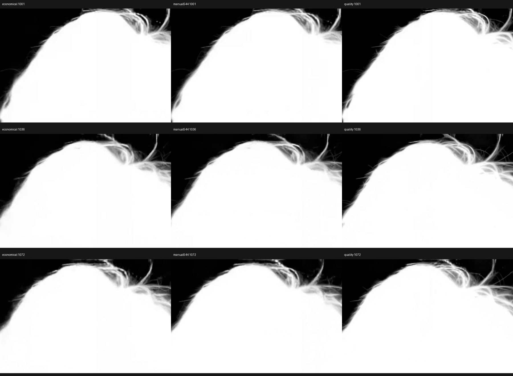

# Quality profiles — RTX 3090 check, 2026-10-13

The Nuke panel now offers Manual, Economy (544), and Quality (768). Manual is the default and preserves old nodes' settings. Quality uses a higher processing resolution and the standard larger VAE tiles on the tested 24 GB GPU. It still uses tiled decode.

## Same-shot comparison

Tears of Steel `TOS_050_0020`, frames 1001–1072 (72 frames), source 1920×1012, 24 fps, seed 1234, automatic foreground selection. Each run wrote a separate EXR cache at the source dimensions. No manual cleanup or SAM selection was applied.

Hardware/runtime: RTX 3090 24 GB, ComfyUI 0.38.1, PyTorch 2.14.0+cu130. The existing backend was idle before each submission and was not restarted between runs. These are individual wall-clock measurements, including staging, loading as needed, inference and EXR export; they are not a repeated benchmark or a controlled cold-start comparison.

| Mode | Model input | Decode tiles (spatial / temporal) | 72 frames |
| --- | --- | --- | --- |
| Economy | 1056×544 | 256 px / 32 frames | 61.4 s |
| Manual, previous default | 1056×544 | 512 px / 128 frames | 59.0 s |
| Quality | 1472×768 | 512 px / 128 frames | 123.8 s |

All three completed without a memory error. The 72 Economy and Quality outputs were checked for matching dimensions, finite alpha values, and the 0–1 range. Changing processing settings invalidates the existing shot cache through its resolution/tile fingerprint.

Whole-GPU memory usage sampled every 0.5 seconds peaked at 23,060 MiB (Economy), 23,520 MiB (Manual), and 22,942 MiB (Quality). These values include reusable backend weights and unrelated desktop apps: they do **not** demonstrate that Quality uses less memory or measure isolated process peaks. Dynamic weight loading and cache state affect total occupancy. Small VAE tiles reduce the decoder's memory requirement; increasing resolution increases the work available to the model.

Native-output hair crops below: Economy, previous 544 larger-tile default, Quality. Quality resolves more separate fine hair strands in these inspected samples. That is a visual observation, not an accuracy score against a reference matte. Some foreground artifacts remain, including a partial second subject at the right edge in the last sample.

Economy versus Quality has mean absolute alpha difference 0.007026; 3.31% of pixels differ by more than 0.05, averaged across frames. Difference measures change, not improvement. No ground-truth matte or motion-compensated temporal evaluation was used.

## Verification

- 66 automated tests passed; one existing optional-dependency test was skipped.
- Nuke 17.1v1, separate process with interactive license: create a node, switch profiles, verify the effective engine command, save/reopen, return to the preserved Manual values, and upgrade a legacy node without overwriting its settings.
- CLI equivalents: Economy adds `--resolution 544 --low-vram`; Quality uses `--resolution 768` without `--low-vram`.
- Full test command: `PYTHONPATH=aitools <engine-python> -m pytest -q AlphaGen/tests` from the repository root.

[Machine-readable measurements](quality-measurements.json).

768 with SAM selection, long overlapping shots at 768, 1088, untiled decode, Windows and physical small GPUs were not tested in this comparison. Existing lower-resolution overlap/SAM checks still apply only to their recorded settings. GPUs up to 8 GB keep automatic small tiles even in Quality. On memory failure, select Economy or Manual at 544; the tool does not silently downgrade the requested resolution.

*Footage: Tears of Steel (CC) Blender Foundation, mango.blender.org, CC BY 3.0.*
